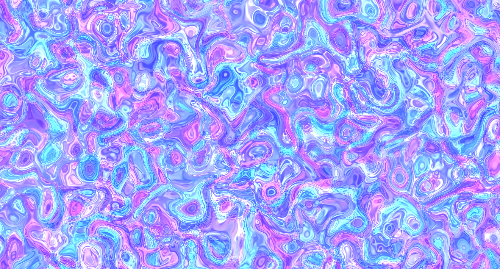

# Noise Soup

Noise Soup is an interactive generative artwork and creative-coding study in responsive matter. A layered triangle-noise field produces a fluid image; pointer movement bends that field, while a press sends a brief wave through it.



## Experience

- **Move or drag** across the artwork to disturb the field. Enable **Stir mode** for a stronger, continuous response.
- Choose **Iris**, **Tide**, or **Ember** to explore the same field through three color studies.
- Select **Re-compose** (or press `R`) to generate a new seed. The current seed stays visible when comparing variations.
- Select **Pause** (or press `Space`) to study a frame. The artwork starts paused when the operating system requests reduced motion.
- Select **Save frame** to export a PNG of the current composition.
- Open **Field notes** for a short explanation of the shader model and the interaction question.

## Design lens

The interaction treats gesture as a visible material cause: pointer position creates a soft local influence, and pressing adds a short-lived ripple. The response is spatial and continuous, so people can learn the mapping by trying it rather than reading instructions first. Palette choice and reseeding make comparison explicit, while the seed readout keeps the current variation identifiable.

The piece asks: **How does a trace become a tool?** It is an exploratory design artifact for thinking about agency, feedback, and legibility in generative systems. It is not a validated HCI study; the interface is a starting point for observation and critique.

## Run locally

The project has no install or build step. Shader source is loaded with `fetch`, so serve the repository root over HTTP rather than opening `index.html` as a file. For example:

```bash
python3 -m http.server 8000
```

Open <http://localhost:8000>. The page loads Three.js 0.88.0 from cdnjs, so an internet connection is required.

## Project structure

```text
.
├── index.html
├── src/
│   ├── assets/
│   │   ├── favicon.svg
│   │   └── img/NoiseSoup.png
│   ├── javascript/sketch.js
│   ├── shaders/
│   │   ├── noise-soup.frag.glsl
│   │   └── noise-soup.vert.glsl
│   └── styles/styles.css
├── LICENSE
└── README.md
```

## Extend the study

Edit `src/shaders/noise-soup.frag.glsl` to change the procedural field, gesture influence, or color mappings. `src/javascript/sketch.js` owns the uniforms, input mapping, animation loop, and image export. The page interface and controls live in `index.html`; their layout is in `src/styles/styles.css`.

The canvas supports pointer and touch input, keyboard controls, visible focus states, and a reduced-motion preference. Use the arrow keys to move the influence point, `S` for Stir mode, `R` for a new seed, and `Space` to pause or resume.

## Credits

The original shader was inspired by tri-noise techniques and references by Liam Egan, Nimitz, Inigo Quilez, Patricio Gonzalez Vivo, and Gary “Shane” Warne. Additional acknowledgements are preserved in the project history.

## License

See [LICENSE](LICENSE) for license details.
